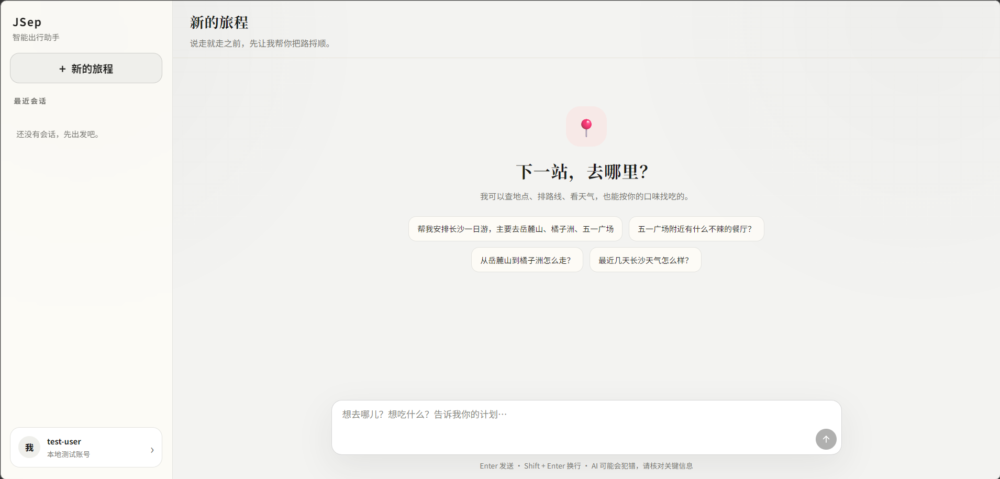
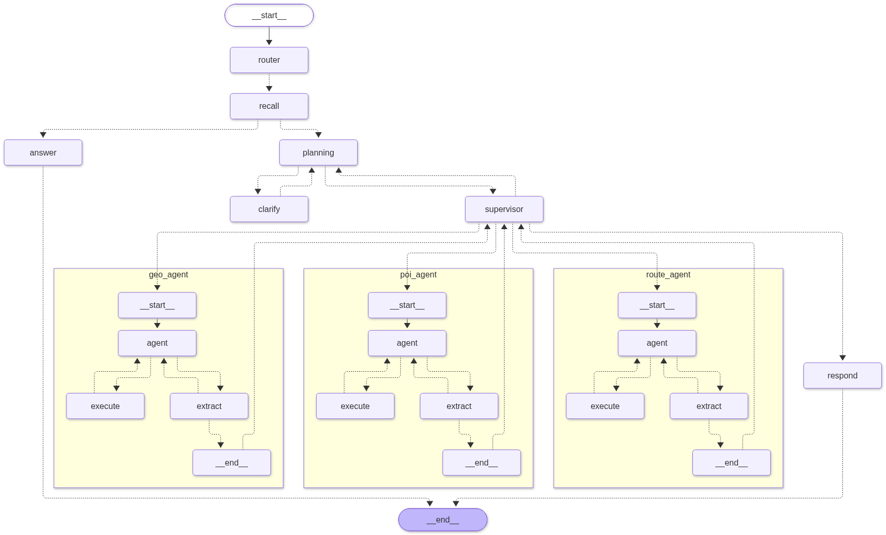

# JSep 智能出行助手

基于 MCP + LangGraph 的多智能体出行助手，支持任务规划、多步工具调用、人工补充、分层记忆和流式对话。

## 界面预览



## 工作流



## 功能

- **多智能体任务编排**：把出行需求拆成地点查询、周边推荐、路线规划等任务，按依赖关系调度。
- **MCP 工具接入**：按 Agent 职责拆分工具域，子 Agent 只加载所属工具，减少 Schema 干扰。
- **人工介入**：缺少关键信息时暂停任务，前端补充、取消后恢复执行。
- **分层记忆**：用户画像注入、历史对话按需召回、最近会话滑动窗口。
- **流式对话**：FastAPI SSE 推送 token、规划、子 Agent 状态和最终回答。
- **完整前端**：会话列表、重命名、删除、历史消息、偏好编辑、规划侧栏。

## 技术栈

```text
Python / FastAPI / LangGraph / LangChain / MCP
PostgreSQL / Milvus / Redis
Vue3 / Vite / SSE
```

## 目录

```text
agents/       多智能体、子 Agent、提示词与上下文
app/          FastAPI 入口和 API
common/       状态、模型、工具函数
services/     ChatService、数据库、缓存、记忆
frontend/     Vue3 + Vite 前端
docs/         截图与架构图
test/         本地测试脚本
```

## 环境要求

- Python 3.11+
- Node.js 18+
- PostgreSQL
- Milvus
- Redis（工具缓存）

## 启动

### 1. 安装后端依赖

```powershell
python -m venv .venv
.\.venv\Scripts\Activate.ps1
pip install -r requirements.txt
```

### 2. 配置环境变量

复制 `.env.example` 为 `.env`，填写：

```text
DEEPSEEK_API_KEY
DASHSCOPE_API_KEY
RERANK_BASE_URL
AMAP_API_KEY
POSTGRE_JSEP
MILVUS_URI
REDIS_URL
```

### 3. 启动后端

```powershell
uvicorn app.main:app --reload --port 8000
```

- API 文档：http://127.0.0.1:8000/docs
- 前端静态页：http://127.0.0.1:8000/app/

### 4. 启动前端开发

```powershell
cd frontend
npm install
npm run dev
```

打开：

```text
http://127.0.0.1:5173/
```

Vite 已把 `/api` 代理到 `http://127.0.0.1:8000`。

### 5. 构建前端静态文件

```powershell
cd frontend
npm run build
```

## API

```text
POST   /api/chat/stream               SSE 流式聊天
POST   /api/chat/resume               人工补充后恢复

GET    /api/threads                   会话列表
POST   /api/threads                   新建会话
PATCH  /api/threads/{thread_id}       重命名
DELETE /api/threads/{thread_id}       删除会话
GET    /api/threads/{thread_id}/messages  历史消息

GET    /api/profile                   用户偏好
PUT    /api/profile                   保存偏好
```

所有接口通过请求头识别用户：

```http
X-User-Id: test-user
```

## 数据说明

- PostgreSQL 保存会话、用户偏好和 LangGraph checkpoint。
- Milvus 保存对话记忆，支持向量召回。
- Redis 缓存 MCP 工具结果，减少重复调用。
- 工具执行失败会返回失败结果，不会伪造地点或数据。
